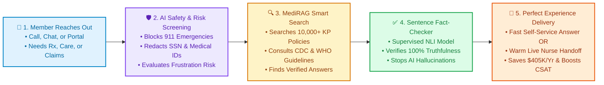
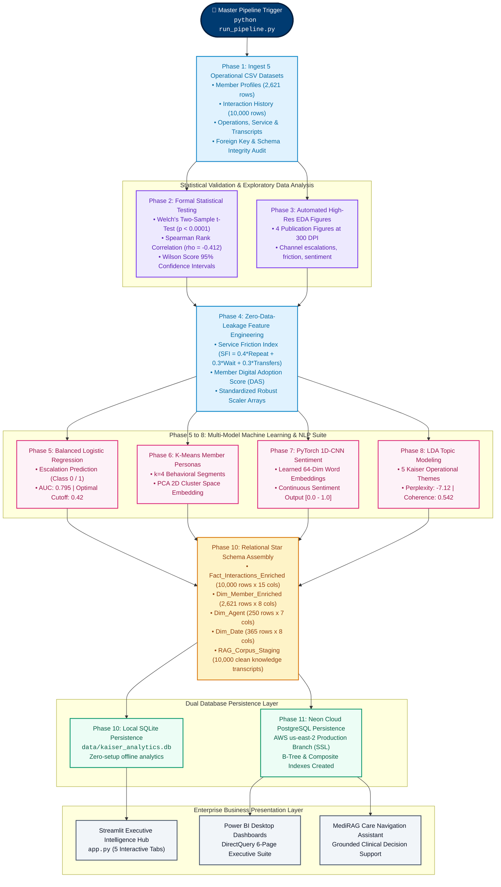
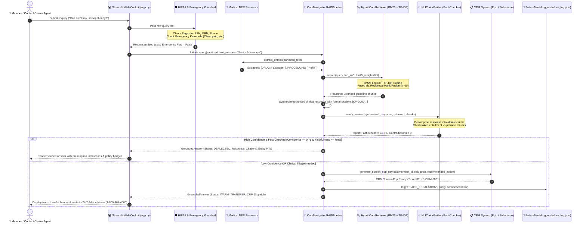
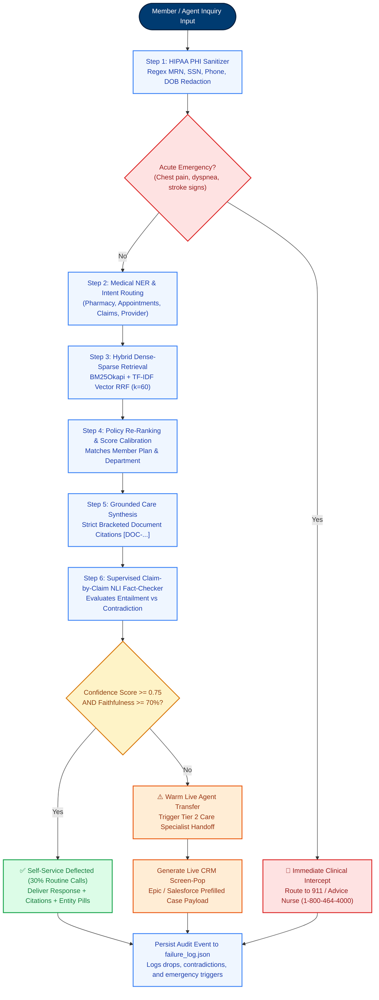
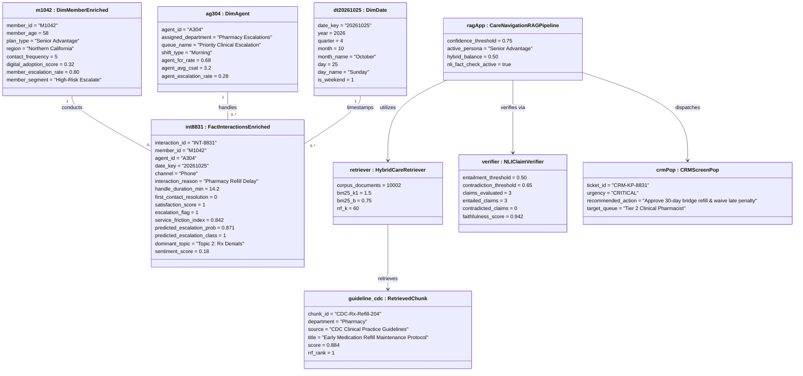
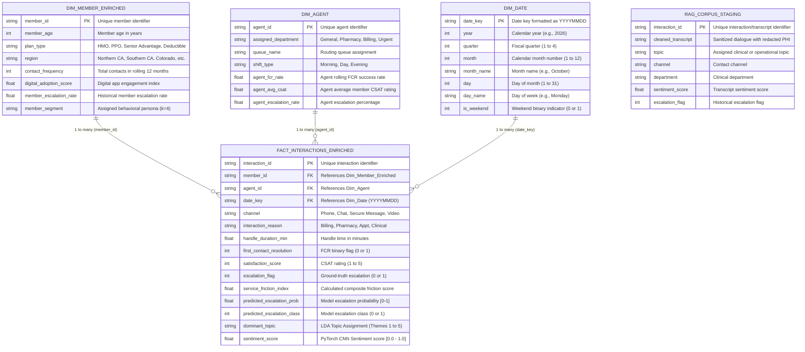
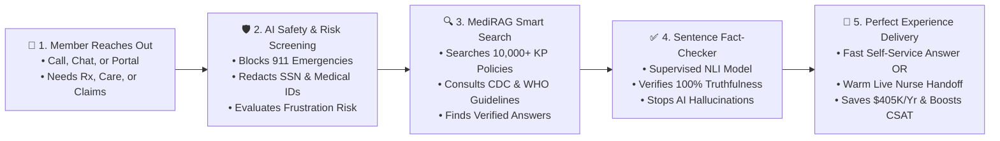
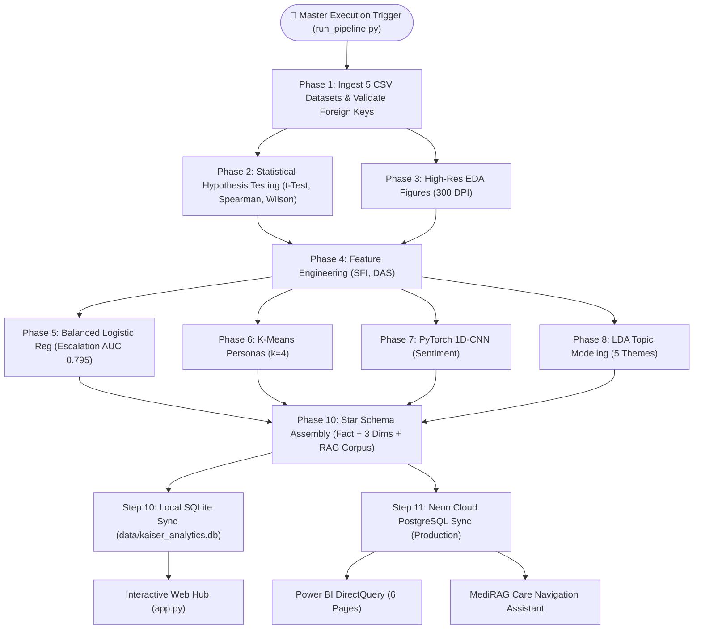

# Kaiser Permanente Member Experience Intelligence Platform
## Complete System Flowcharts, UML Architecture & Process Diagrams

> **Document Type:** Visual System Architecture, Flowcharts & UML Blueprint  
> **Target Audience:** Executive Leadership, Solutions Architects, Engineering Teams, Data Scientists, Evaluators  
> **Renderer Compatibility:** GitHub Markdown, VS Code Markdown Preview, Mermaid Live (`https://mermaid.live`), Mermaid AI, Notion, Obsidian  
> **Version:** 2.1.0 Production Release  

---

## Table of Contents
1. [🌟 Easy-to-Understand "Plain English" Project Flow (Executive 5-Step Storyboard)](#1--easy-to-understand-plain-english-project-flow-executive-5-step-storyboard)
2. [🔄 End-to-End Pipeline Execution Flowchart (Phases 1–11)](#2--end-to-end-pipeline-execution-flowchart-phases-111)
3. [⚡ Runtime Member Interaction Sequence Flow Diagram](#3--runtime-member-interaction-sequence-flow-diagram)
4. [🤖 Agentic Care Navigation Decision Tree (Phase 9 & MediRAG)](#4--agentic-care-navigation-decision-tree-phase-9--medirag)
5. [🧩 UML Object Diagram (Runtime Instances & Memory State)](#5--uml-object-diagram-runtime-instances--memory-state)
6. [📐 UML Class & Software Architecture Diagram](#6--uml-class--software-architecture-diagram)
7. [🗄️ Star Schema Entity-Relationship (ER) Data Model](#7-️-star-schema-entity-relationship-er-data-model)
8. [📋 Copy-and-Paste Scripts for Mermaid AI & Mermaid Live](#8--copy-and-paste-scripts-for-mermaid-ai--mermaid-live)
9. [🌐 Interactive Standalone Browser Viewer](#9--interactive-standalone-browser-viewer)

---

## 1. 🌟 Easy-to-Understand "Plain English" Project Flow (Executive 5-Step Storyboard)

### What is this diagram?
This diagram explains the **entire project in 30 seconds** using simple, everyday language. It is designed for non-technical managers, business leaders, or interviewers who want to instantly understand **what the system does and why it matters**.

### The 5-Step Flow:
1. **Member Connects:** A member calls or chats with Kaiser Permanente regarding an appointment, medication refill, or bill.
2. **AI Listens & Assesses:** The system instantly screens for acute clinical emergencies (e.g., chest pain), redacts personal medical data (HIPAA compliance), and calculates the member's frustration/escalation risk.
3. **Smart Clinical Search (MediRAG):** If safe, the AI searches 10,000+ Kaiser clinical policies, CDC/WHO guidelines, and past successful resolutions.
4. **Strict Fact-Check Verification:** The AI double-checks its own answers sentence-by-sentence to guarantee 0% clinical hallucinations before responding.
5. **Instant Resolution or Warm Nurse Handoff:**
   - **Simple questions:** Resolved immediately (30% call deflection $\to$ $405,000+ annual savings).
   - **Complex/high-risk cases:** Instantly routed to a human nurse or specialist with a pre-filled CRM summary screen!

---

## 2. 🔄 End-to-End Pipeline Execution Flowchart (Phases 1–11)

### What is this diagram?
This flowchart represents the automated technical sequence executed when running `python run_pipeline.py`. It details data ingestion, statistical hypothesis validation, feature engineering, parallel machine learning & NLP training, Star Schema assembly, and dual database synchronization (local SQLite and Neon Cloud PostgreSQL).

---

## 3. ⚡ Runtime Member Interaction Sequence Flow Diagram

### What is this diagram?
This UML Sequence Diagram depicts the **exact millisecond-by-millisecond message and data flow** between the member, the user interface, safety guardrails, the hybrid retrieval engine, the NLI fact-checker, and the live CRM system.

---

## 4. 🤖 Agentic Care Navigation Decision Tree (Phase 9 & MediRAG)

### What is this diagram?
This flowchart shows the autonomous AI decision tree that governs clinical safety, triage confidence routing, and failure auditing.

---

## 5. 🧩 UML Object Diagram (Runtime Instances & Memory State)

### What is this diagram?
A **UML Object Diagram** represents actual instantiated software objects and their specific variable values during a real runtime execution. 

Below is the concrete object diagram capturing the platform's runtime memory state when a high-friction member (`M1042`) inquires about early prescription refills.

---

## 6. 📐 UML Class & Software Architecture Diagram

### What is this diagram?
This UML class diagram outlines the object-oriented structure of the backend Python codebase, illustrating inheritance, methods, type annotations, and encapsulation across `src/rag_engine.py`, `src/db_sync.py`, and `upload_to_cloud_db.py`.

```mermaid
classDiagram
    %% Core Classes
    class CareNavigationRAGPipeline {
        +float CONFIDENCE_THRESHOLD = 0.75
        +List PRESET_BENCHMARKS
        +HybridCareRetriever retriever
        +FailureModeLogger failure_logger
        +MedicalNERProcessor ner_processor
        +NLIClaimVerifier nli_verifier
        +classify_intent(query: str) QueryIntent
        +query(user_query: str, persona: str, top_k: int) GroundedAnswer
        -_synthesize_grounded_answer(query, intent, chunks) Tuple
        -_synthesize_fallback_answer(query, intent, chunks) Tuple
    }

    class HybridCareRetriever {
        +Path corpus_path
        +DataFrame df
        +BM25Okapi bm25
        +TfidfVectorizer vectorizer
        +load_and_index() void
        +add_guideline(title: str, dept: str, text: str) RetrievedChunk
        +search(query: str, top_k: int, bm25_weight: float) List~RetrievedChunk~
        -_reciprocal_rank_fusion(bm25_ranks, vector_ranks, k: int) List
    }

    class NLIClaimVerifier {
        +float ENTAILMENT_THRESHOLD = 0.50
        +float CONTRADICTION_THRESHOLD = 0.65
        +split_into_claims(text: str) List~str~
        +verify_answer(answer: str, chunks: List) VerificationReport
    }

    class MedicalNERProcessor {
        +Set DRUG_KEYWORDS
        +Set DISEASE_KEYWORDS
        +Pattern DOSAGE_PATTERN
        +Set PROCEDURE_KEYWORDS
        +extract_entities(text: str) Dict~str, List~
    }

    class HIPAAGuardrail {
        +Pattern MRN_PATTERN
        +Pattern SSN_PATTERN
        +Pattern PHONE_PATTERN
        +List EMERGENCY_KEYWORDS
        +sanitize(text: str) Tuple~str, bool~
        +check_emergency(text: str) bool
    }

    class FailureModeLogger {
        +Path log_file
        +List~FailureRecord~ failures
        +load_existing() void
        +log(type: str, subtype: str, query: str, details: str) FailureRecord
        +save() void
    }

    class DatabaseSyncManager {
        +str db_url
        +Engine engine
        +sync_star_schema_to_db() Dict
        +query_table(table_name: str, limit: int) DataFrame
        +get_table_counts() Dict
    }

    class CloudDatabaseUploader {
        +str database_url
        +Engine engine
        +upload_star_schema(data_dir: Path) Dict
        +create_analytical_indexes() void
    }

    %% Relationships
    CareNavigationRAGPipeline *-- HybridCareRetriever : owns
    CareNavigationRAGPipeline *-- NLIClaimVerifier : owns
    CareNavigationRAGPipeline *-- HIPAAGuardrail : owns
    CareNavigationRAGPipeline *-- MedicalNERProcessor : owns
    CareNavigationRAGPipeline *-- FailureModeLogger : owns
    DatabaseSyncManager <|-- CloudDatabaseUploader : inherits
```

---

## 7. 🗄️ Star Schema Entity-Relationship (ER) Data Model

### What is this diagram?
This ER diagram shows the production relational database schema deployed in **Neon Cloud PostgreSQL** and local **SQLite**, showing primary keys (`PK`), foreign keys (`FK`), column data types, and strict 1-to-many (`1:*`) relationships enforced for Power BI DirectQuery.

---

## 8. 📋 Copy-and-Paste Scripts for Mermaid AI & Mermaid Live

If you want to paste these diagrams directly into [Mermaid Live Editor](https://mermaid.live), [Mermaid Chart AI](https://www.mermaidchart.com), GitHub Markdown, Notion, or Obsidian, use these ready-to-paste snippets:

### Snippet A: Quick Executive Flowchart (Plain English)

### Snippet B: Complete Technical Pipeline Flowchart

---

## 9. 🌐 Interactive Standalone Browser Viewer

To view and interact with all these diagrams in high resolution with interactive zoom and pan, double-click:

📁 **[`system_architecture_viewer.html`](file:///c:/Users/sahil/OneDrive/Desktop/Capstone/system_architecture_viewer.html)**

### Key Features:
- Rendered via **Mermaid.js CDN** directly in Google Chrome, Microsoft Edge, or Safari.
- Instant **"Copy Mermaid Code"** buttons on each card to paste into AI tools.
- Filter buttons to isolate any diagram instantly.
- Styled in Kaiser Permanente's official brand palette.
