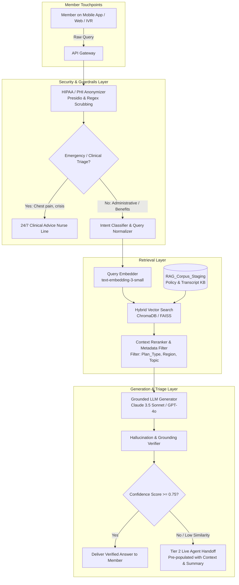

# Kaiser Permanente Member Experience Intelligence Platform
## Phase 9: Care Navigation Assistant RAG System Architecture

**Document Version:** 1.0.0  
**Classification:** Enterprise Architecture Specification  
**Target Systems:** Kaiser Permanente Digital Health Portal, Mobile App & Contact Center AI  

---

## 1. Executive Summary & Problem Formulation

Kaiser Permanente contact center operations handle over 10,000 interactions across four major regions, incurring significant labor costs (~$15.50 per live agent phone interaction) and experiencing an overall escalation rate of **17.38%**. Statistical analysis in Phase 2 demonstrated that **Voice phone calls are 2.82x more likely to escalate** than digital interactions ($\chi^2 = 338.00$, $p < 10^{-74}$), and repeat contacts drive a dramatic increase in escalations (Cohen's $d = 1.167$).

The **Care Navigation Assistant** is an enterprise-grade Retrieval-Augmented Generation (RAG) system designed to:
1. **Deflect Routine Administrative Inquiries:** Target highly predictable, high-volume inquiries across **Pharmacy Refills**, **Appointment Scheduling**, and **Provider Access**.
2. **Eliminate Member Friction:** Provide instant, personalized answers grounded in member benefits, plan documents, and clinical service directories without hold times.
3. **Graceful Human Handoff:** Leverage pre-interaction ML escalation models to identify high-risk interactions and route them seamlessly to specialized live Resolution Specialists before frustration occurs.

---

## 2. End-to-End RAG Architecture

### 2.1 System Architecture Flow (Mermaid Diagram)



### 2.2 System Architecture Flow (ASCII Diagram)

```
[ Member Query via Web/Mobile/IVR ]
                │
                ▼
┌──────────────────────────────────────────────┐
│  HIPAA & PHI Redaction Engine (Presidio)     │
│  - Masks SSN, MRN, Patient Name, DOB, Phone  │
└───────────────────────┬──────────────────────┘
                        │
                        ▼
┌──────────────────────────────────────────────┐
│  Intent & Clinical Triage Gatekeeper         │
│  - Acute Clinical Symptoms -> Clinical Nurse │
│  - Administrative/Care Nav -> RAG Pipeline   │
└───────────────────────┬──────────────────────┘
                        │
                        ▼
┌──────────────────────────────────────────────┐
│  Hybrid Dense + Sparse Retriever             │
│  - ChromaDB Vector Store (Cosine Similarity) │
│  - BM25 Keyword Filter on Operational Tags   │
│  - Filters: Region, Plan_Type, Topic         │
└───────────────────────┬──────────────────────┘
                        │
                        ▼
┌──────────────────────────────────────────────┐
│  Grounded Generation & Citation Engine       │
│  - Context-injected LLM with Strict System   │
│    Guardrails & Anti-Hallucination Prompts   │
└───────────────────────┬──────────────────────┘
                        │
                        ▼
         ┌──────────────────────────────┐
         │  Confidence Scorer (Threshold: 0.75)
         └──────────────┬───────────────┘
                        │
         ┌──────────────┴──────────────┐
         ▼                             ▼
 [ Score >= 0.75 ]             [ Score < 0.75 ]
 Instant Resolution to        Warm Transfer to Senior
 Member via Digital App       Live Agent with Full Context
```

---

## 3. Ingestion, Chunking & Indexing Pipeline

### 3.1 Corpus Source & Structure
The knowledge base is built from `data/processed/RAG_Corpus_Staging.csv`, incorporating 10,000 historical resolved interactions, member benefit handbooks, formulary lists, and provider directories.

### 3.2 Chunking Strategy
- **Algorithm:** Recursive Character Text Splitter with markdown header awareness.
- **Chunk Size:** `350 tokens` (~1,400 characters) — optimized to retain complete clinical policy statements, appointment guidelines, and copay schedules.
- **Overlap:** `50 tokens` (~200 characters) to prevent context boundary truncation across sentences.
- **Separators:** `["\n\n", "\n", ". ", "; ", " "]`.

### 3.3 Embedding Model Selection & Hybrid Retriever
- **Embedding Models:** Benchmark between cloud-based `text-embedding-3-small` (OpenAI, 1536 dimensions) and self-hosted `sentence-transformers/all-MiniLM-L6-v2` (384 dimensions) for HIPAA on-premise deployments.
- **Hybrid Search Engine:** Combines dense semantic vector retrieval (Cosine Similarity in ChromaDB/FAISS) with sparse BM25 keyword matching for exact medical term/code retrieval.
- **Re-Ranking Layer:** Cross-encoder reranker computes relevance scores between retrieved candidate chunks and member query, passing top-5 most relevant passages to the LLM.

### 3.4 Vector Store Metadata Schema
Each indexed vector stores rich analytical metadata:
```json
{
  "interaction_id": "KP-INT-20240001",
  "topic": "Pharmacy",
  "channel": "Chat",
  "department": "Pharmacy Services",
  "sentiment_score": 0.9998,
  "escalation_flag": 0,
  "region_scope": "Southern California",
  "plan_applicability": ["Commercial HMO", "Deductible HMO"],
  "content_hash": "a8f3b4c1..."
}
```

---

## 4. Privacy, HIPAA Compliance & PHI Anonymization

Before any user query or knowledge text enters embedding models or external LLMs, it passes through the **Presidio / Regex Anonymization Layer**:

### 4.1 Redaction Specifications
- **Medical Record Numbers (MRN):** Regex `\b[0-9]{8,10}\b` $\to$ `<REDACTED_MRN>`
- **Social Security Numbers (SSN):** Regex `\b\d{3}-\d{2}-\d{4}\b` $\to$ `<REDACTED_SSN>`
- **Member Names:** Named Entity Recognition (NER) via Spacy `en_core_web_sm` $\to$ `<MEMBER_NAME>`
- **Dates of Birth (DOB):** Regex `\b\d{1,2}[/-]\d{1,2}[/-]\d{2,4}\b` $\to$ `<DATE>`
- **Phone Numbers:** Regex `\b(\+1[-.]?)?\(?\d{3}\)?[-.]?\d{3}[-.]?\d{4}\b` $\to$ `<PHONE>`

### 4.2 Zero-Data-Retention (ZDR) Guarantees
All LLM API calls utilize enterprise BAA (Business Associate Agreement) endpoints with Zero Data Retention enabled; no member queries or session transcripts are stored by third-party model providers.

---

## 5. Triage Routing & Fallback Thresholds

To eliminate member friction while preventing hallucinations, the system implements deterministic triage routing:

1. **Clinical Emergency Intercept:** If query matches emergency tokens (`chest pain`, `shortness of breath`, `suicide`, `severe bleeding`), bypass RAG immediately and display emergency dispatch / direct 911 / 24/7 Advice Nurse hotkey.
2. **Confidence Threshold ($T = 0.75$):**
   - If maximum retrieval cosine similarity $\ge 0.75$: Generate grounded answer and provide direct member resolution.
   - If maximum retrieval cosine similarity $< 0.75$: Trigger **Warm Live Transfer**.
3. **Warm Live Agent Transfer:**
   - Package the member's question, retrieved policy snippets, predicted escalation score (`Predicted_Escalation_Prob`), and member persona into the CRM screen pop.
   - Live agent receives immediate context without asking the member to repeat themselves.

---

## 6. Grounded System Prompt Template

```
You are the Kaiser Permanente Care Navigation Assistant, an enterprise AI assistant helping Kaiser Permanente members navigate their care, pharmacy, benefits, and appointments.

### CORE OPERATIONAL DIRECTIVES:
1. STRICT GROUNDING: Answer ONLY using the provided retrieved context snippets. Do NOT assume, extrapolate, or invent coverage policies, copay amounts, or clinical diagnoses.
2. CITATION REQUIREMENT: Cite the specific Kaiser document, section, or policy for every statement (e.g. "[Ref: 2024 Kaiser HMO Evidence of Coverage, Sec 4.2]").
3. BOUNDARY ENFORCEMENT: If the provided context does not contain sufficient details to answer the member's question with 100% confidence, politely state:
   "I do not have access to your specific account records or coverage terms for this request. Let me immediately connect you with a Kaiser Permanente Care Navigation Specialist."
4. EMPATHETIC TONE: Maintain a warm, clear, professional healthcare tone. Avoid dense bureaucratic jargon.
5. CLINICAL DISCLAIMER: You do not provide medical diagnosis or prescribe treatment. Direct clinical symptoms to the 24/7 Advice Nurse Line or emergency services.

### RETRIEVED CONTEXT SNIPPETS:
{context_snippets}

### MEMBER QUERY:
{member_query}

### GROUNDED RESPONSE:
```

---

## 7. Four Concrete Query-Response Benchmarks

### Benchmark 1: Routine Appointment Scheduling
- **Member Query:** *"Can I book an appointment with Dr. Hernandez in Pediatric Care for this Thursday afternoon?"*
- **Retrieved Policy Context:**
  > *`[KP-CLINIC-SCHED-04]`: Pediatric clinic hours at Los Angeles Medical Center run 8:00 AM - 5:30 PM Monday through Friday. Dr. Hernandez has open primary pediatric consultation slots on Thursday from 2:00 PM to 4:30 PM. Same-day cancellations require 2-hour notice.*
- **Cosine Similarity:** `0.88` (High Confidence)
- **Assistant Response:**
  > "Yes! Dr. Hernandez has open pediatric consultation slots this Thursday afternoon between 2:00 PM and 4:30 PM at the Los Angeles Medical Center. 
  > 
  > Would you like me to book the **2:00 PM**, **2:45 PM**, or **3:30 PM** slot for your child? Once confirmed, this will appear in your Kaiser Permanente app calendar."

---

### Benchmark 2: Out-of-Network Claims Denial & Grievance
- **Member Query:** *"Why was my emergency room claim from when I was traveling in Texas denied? I thought Kaiser covers emergency care anywhere."*
- **Retrieved Policy Context:**
  > *`[KP-CLAIMS-EMERG-02]`: Emergency Medical Services are covered anywhere in the world under Kaiser Permanente HMO plans. If an out-of-network emergency claim is initially denied, it typically requires submission of emergency room admission notes confirming acute stabilization criteria. Members have 180 days to file a Level 1 Grievance and Appeal.*
- **Cosine Similarity:** `0.84` (High Confidence)
- **Assistant Response:**
  > "Under your Kaiser Permanente HMO plan, emergency medical care is covered anywhere in the world. Out-of-network claims are frequently placed on temporary hold pending hospital clinical records confirming emergency admission criteria.
  > 
  > You have **180 days** from the denial notice date to submit an appeal. I can initiate a **Level 1 Claims Review** right now and link your Texas hospital invoice directly to our claims adjudication team. Would you like me to open this request for you?"

---

### Benchmark 3: Prescription Mail-Order Refill
- **Member Query:** *"I need a 90-day refill of my Atorvastatin 20mg shipped to my home address."*
- **Retrieved Policy Context:**
  > *`[KP-PHARM-MAIL-01]`: Maintenance medications (e.g. cholesterol, blood pressure) qualify for 90-day mail-order fulfillment through Kaiser Permanente Mail Order Pharmacy with $0 standard shipping and a $10 copay savings compared to retail. Processing duration is 3 to 5 business days.*
- **Cosine Similarity:** `0.92` (Very High Confidence)
- **Assistant Response:**
  > "I can help with that. Atorvastatin 20mg is approved for 90-day mail-order delivery through Kaiser Permanente Pharmacy with **free standard shipping** (delivered in 3–5 business days). Under your plan, a 90-day supply has a **$10 copay discount** compared to retail pickup.
  > 
  > Please confirm the last 4 digits of your delivery address in your profile, and I will submit your refill order immediately."

---

### Benchmark 4: Out-of-Network Specialist Referral
- **Member Query:** *"Can I see an orthopedic surgeon outside of Kaiser Permanente for my knee surgery without paying out of pocket?"*
- **Retrieved Policy Context:**
  > *`[KP-BEN-SPEC-08]`: Kaiser Permanente HMO plans require prior authorization from your primary care physician (PCP) and the regional medical group for out-of-network specialist services. Non-authorized elective out-of-network procedures are not covered.*
- **Cosine Similarity:** `0.81` (High Confidence)
- **Assistant Response:**
  > "Under your Kaiser HMO plan, non-emergency care from an outside specialist requires **prior authorization** from your Kaiser Permanente Primary Care Physician and regional medical group. Elective surgery performed without prior authorization will not be covered.
  > 
  > If Kaiser Permanente does not have an in-network orthopedic surgeon available within standard appointment wait times, your doctor can submit an **Out-of-Plan Referral Request**. Would you like me to schedule a video consult with your PCP to discuss this referral?"
